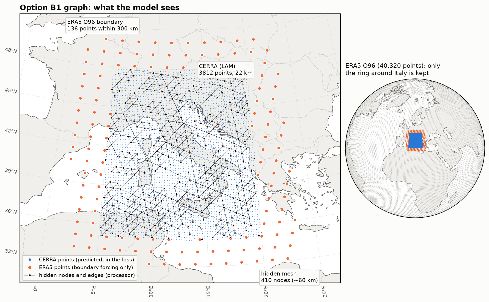

# Option B1 · Italy limited-area model ★★★

**A regional forecaster nested in a global one.** Inside a box around Italy the model sees and predicts
**CERRA**, the 5.5 km European regional reanalysis (thinned to 22 km here). Around the box it gets a ring of
**global ERA5 O96** points (~1°). Those points are only *boundary forcing*: they are inputs and are never
predicted or scored. This is how national weather services run their regional models, and anemoi supports
it directly through config.

*3812 CERRA points (blue) are predicted. 136 ERA5 points within 300 km (orange) are boundary inputs. 410
hidden nodes (black) carry the processor. Everything else in the 40,320-point O96 grid is dropped.
Regenerate the figure with `python scripts/plot_lam_graph.py`.*

## Why

Three parts of anemoi work together here, and each is a few lines of config:

* **Dataset composition (anemoi-datasets).** `cutout: [LAM, global]` returns *one* dataset: all points of the
  first dataset, followed by the points of the second that the first does not cover. `area` and `thinning` cut
  and coarsen CERRA. `adjust: all` keeps only the variables both datasets have. `max_distance_km` drops global
  points far from the LAM. The model never knows there were two datasets: it sees 3948 points.
* **A limited-area graph (anemoi-graphs).** `graph: limited_area` puts hidden nodes (`LimitedAreaTriNodes`)
  only over the points where `cutout_mask` is true, the CERRA ones. The encoder has extra edges from the
  boundary points (`boundary_mask` = not `cutout_mask`). The decoder only goes to the CERRA points.
* **Masked training (anemoi-training).** `model.output_mask` (`Boolean1DMask` on `cutout_mask`) tells training
  which points the model is responsible for. The loss weights (`node_weights`) are set to zero outside it, and
  in a rollout the boundary is refilled from the data rather than the forecast. `training: lam` adds a
  validation metric, `mse_inside_lam`, in physical units per variable.

## What to do

1. `cp skeleton.yaml mine.yaml` and fill the `???`:
   * **TODO(1)** `graph: limited_area` and `training: lam` in `defaults`.
   * **TODO(2)** the **order** of the cutout: `${system.input.dataset}` (CERRA) first,
     `${system.input.forcing_dataset}` (O96) second. The first dataset is the one that wins where both exist,
     and `cutout_mask` marks its points.
   * **TODO(3)** the Italy box `area: [N, W, S, E]` and `thinning`. `[48, 5, 35, 20]` and 4 are tested:
     22 km, 3812 points.
   * **TODO(4)** `max_distance_km`: how far from the LAM global points are kept. Upstream uses 300 km.
   * **TODO(5)** the `forcing` and `diagnostic` lists. Only 13 variables exist in both datasets: `msl`, `sp`,
     `t_50`, `t_100`, `tp` and the 8 cos/sin forcings. The defaults from `data/zarr.yaml` (`lsm`, `z`,
     `insolation`, `cp`, ...) are ERA5-only. `validate` does **not** catch a wrong name: the job fails after
     ~5 min (see the table below).
   * **TODO(6)** the hidden-mesh `resolution`: 6 (~120 km, 103 nodes), 7 (~60 km, 410 nodes) or 8 (~30 km,
     1613 nodes).
   * **TODO(7)** `attribute_name` of the output mask: `cutout_mask`.
   * **TODO(8)** a run name, e.g. `B1-thin4-tri7-<you>`.
2. Validate, submit, plot (see `../README.md`).

The graph file name follows `thinning` and `resolution` automatically
(`lam_italy_thin<N>_tri<R>.pt` in `$SCRATCH/aiwcas26/hour2/graphs/`). It is built on your first run in about
10 s. If you change `area` or `max_distance_km`, also change the `italy` part of the name, or the old graph
(with the old points) is reused and training fails with a size mismatch after startup.

## Things to try once it runs

* **Hidden resolution 6 vs 8.** About 4× fewer or more processor nodes. Is the loss lower? What does a step
  cost?
* **Thinning 2** (11 km, 15,282 points, 4× the data). Is the job still under 10 min?
* **A smaller box**, e.g. northern Italy `[47.5, 6, 43, 14.5]`: fewer points, and the boundary is closer to
  everything.
* **`max_distance_km: 100`**: a thinner boundary ring. Does the loss suffer?

Change one thing at a time and give each run its own name (`--name B1-tri8-<you>`). The scoreboard puts
all B1 runs in one comparison group (`MSE(LAM)`).

## Expected outcome

The training loss (`train_multi_dataset_loss_step`, the masked MSE over Italy) drops clearly within 500 steps.
In the GPU dry run it went from 0.51 to 0.12. The model is tiny (0.57 M parameters, 5 output variables, ~4k
points): 500 steps take under a minute (~16 it/s), and most of the 6-minute job is startup. The validation loss
is noisy: 0.14 after the first epoch, a bump to ~0.22 while the learning rate is high, then 0.12 at the end.
There are only 4 validation samples over a small area, so a single weather situation moves it a lot. The loss is **not** comparable with options 0/A/C (different grid, variables and area). Compare B1
runs with each other, and use the normalised plot in `compare.ipynb` to set B1 beside the others.

For a physical number, open `val_data_mse_inside_lam_metric/data/msl/1` in your MLflow metrics
(`$SCRATCH/aiwcas26/hour2/B1_lam/logs/mlflow/<exp>/<run>/metrics/`). Its square root is the 6-h msl RMSE in Pa
over Italy: about 260 Pa (2.6 hPa) in the dry run.

## B1-specific problems

| you see | it means | do |
|---|---|---|
| `You must specify 'graph'` / `'training'` | TODO(1) not filled | `limited_area`, `lam` |
| `Missing mandatory value: dataloader.dataset.cutout[0].dataset` | TODO(2) not filled | the two `${system.input...}` names |
| `AssertionError: Data indexing has invalid entries [...]` (in the job, after startup) | a forcing or diagnostic that CERRA does not have (TODO 5) | only the 8 cos/sin forcings, diagnostic `[tp]` |
| `ValueError: Thinning only works latitude/longitude fields` (in the job) | the cutout order is swapped: O96 (a 1-D grid) got the `thinning` | CERRA first |
| `RuntimeError: Sizes of tensors must match ... Expected size 763 but got size 3948` (in the job) | you changed `area`/`max_distance_km` but kept the graph name: the old graph was reused | new graph name |

## Data (instructor notes)

* `scripts/download_data.sh` fetches the public CERRA test sample (987 MB tgz, 1.2 GB unpacked, CC-BY-4.0):
  1069 × 1069 Lambert grid, the same 39 dates as the O96 sample, 17 variables.
* The full sample stores each date as **one 78 MB zarr chunk** (all variables, all 1.14 M points). A training
  sample needs 3 dates, so every sample would decompress ~230 MB to keep a few thousand points.
  `scripts/crop_cerra.py` writes a 322 × 294 window around Italy (33–50° N, 3–25° E, native 5.5 km, 96 MB,
  6 MB per date). The grid stays 2-D, so `area` and `thinning` still work on it. The statistics are recomputed
  on the window. A 3-date sample then reads in ~0.02 s (13–22 s from the full sample on the loaded login node).
* CERRA `tp` is in kg m⁻² (mm), ERA5 `tp` in m. After `cutout` the boundary ring's `tp` is 1000× too small.
  This is harmless here: `tp` is diagnostic (never an input), and the loss ignores the boundary.
